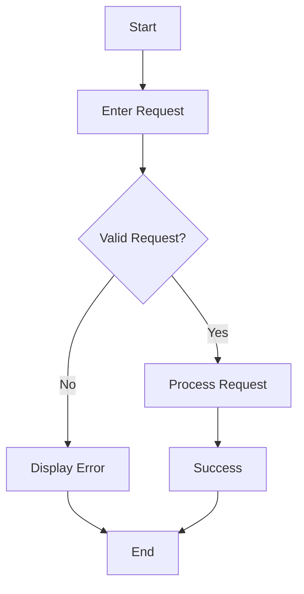

# RICE-POT Prompt — Jira AI Test Case Generator Application

## R — Role

You are a **Senior Python Full-Stack Engineer, QA Automation Architect, and AI Application Developer** with expertise in:

* Python
* Streamlit
* Jira REST API
* Jira authentication
* REST API integration
* QA/Test Case Design
* Local LLM integration using Ollama
* Hosted LLM integration using Groq
* Prompt engineering
* RICE-POT framework
* Configuration and credential management
* Lightweight internal QA productivity applications

You are building a lightweight internal **Jira-to-Test-Case AI application** for a software testing team.

The application must allow a tester to enter a Jira ticket ID, automatically retrieve the Jira requirement, process it using a predefined test-case template, and generate structured test cases using an LLM.

The application should prioritize **local Ollama execution** and use **Groq as an optional fallback**.

---

# I — Instructions

## 1. Application Objective

Build a simple **two-screen Streamlit application** that allows a tester to:

1. Configure Jira and AI provider settings.
2. Enter a Jira ticket ID or natural-language request.
3. Automatically fetch the Jira ticket details.
4. Read the appropriate test-case template.
5. Generate test cases using the configured LLM.
6. Display the generated test cases in a ChatGPT-style interface.

Example user request:

> Create test cases for QA-102

The application should:

```text
User Request
     ↓
Extract Jira ID
     ↓
Fetch Jira Ticket
     ↓
Read Jira Details
     ↓
Select Test Case Type
     ↓
Load Template
     ↓
Build AI Prompt
     ↓
Ollama Qwen 2.5 3B
     ↓
If Ollama unavailable → Groq
     ↓
Generate Test Cases
     ↓
Display Result
```

---

# 2. Frontend Requirements

Use **Streamlit** for the frontend unless there is a strong technical reason to use another lightweight Python UI framework.

The UI must contain two screens.

## Screen 1 — Chat / Test Case Generator

Create a ChatGPT-style interface.

The screen should contain:

### Test Case Type Dropdown

Provide the following options:

1. Functional Test Case
2. Field-Level Test Case
3. Flow Diagram Test Case

The design should allow additional test-case types to be added later.

### Chat Input

Provide a text input/chat input where the tester can enter requests such as:

```text
Create test cases for QA-102
```

or:

```text
Generate functional test cases for PROJ-123
```

or:

```text
Create field-level test cases for ABC-456
```

### Send Button

When the user clicks **Send**:

1. Identify the Jira ticket ID.
2. Validate the Jira ID.
3. Fetch the Jira ticket.
4. Extract relevant requirement information.
5. Select the requested test-case template.
6. Build the final AI prompt.
7. Send the prompt to the selected LLM.
8. Generate the test cases.
9. Display the result in the chat interface.

### Chat Response

The generated result should be displayed in a readable structured format.

The application should preserve the conversation in Streamlit session state so that previous user requests and AI responses remain visible during the session.

---

# 3. Screen 2 — Settings

Create a separate Settings screen.

The Settings screen must allow the user to configure and save:

## Jira Configuration

```text
Jira Base URL
Jira Email ID
Jira API Token
```

Example:

```text
Jira Base URL:
https://your-company.atlassian.net

Jira Email:
tester@example.com

Jira API Token:
***************
```

## LLM Configuration

Provide a provider selection:

```text
Ollama
Groq
```

### Ollama Configuration

Default:

```text
Provider: Ollama
Endpoint: http://localhost:11434
Model: qwen2.5:3b
```

Do not download or pull the model.

Assume that Ollama is already installed and running locally and that the required Qwen model is already available.

The application should only connect to the existing Ollama server.

### Groq Configuration

Allow the user to enter:

```text
Groq API Key
```

The Groq API key must never be hardcoded.

It must be stored through the application's local configuration mechanism.

---

# 4. Credential Security

Do NOT hardcode any credentials.

The following values must never appear directly inside Python source code:

```text
Jira URL
Jira Email
Jira API Token
Groq API Key
```

Store configuration locally using a simple configuration mechanism such as:

```text
config.json
```

or:

```text
SQLite
```

For this lightweight application, prefer the simplest secure local configuration mechanism.

The configuration file must be excluded from Git using:

```text
.gitignore
```

Example:

```text
config.json
.env
```

Never print Jira API tokens or Groq API keys in the UI, logs, or error messages.

Password/token fields should use masked input.

---

# 5. Jira Integration

Create a dedicated Jira client module.

The Jira client must:

1. Connect to the configured Jira URL.
2. Authenticate using the configured Jira email and API token.
3. Accept a Jira issue key such as:

```text
QA-102
PROJ-123
ABC-456
```

4. Fetch the Jira issue through the Jira REST API.
5. Extract useful information.

At minimum extract:

```text
Issue Key
Summary
Description
Acceptance Criteria
Issue Type
Priority
Status
Labels
Components
```

If some fields are unavailable, do not invent them.

Use:

```text
N/A
```

or omit the unavailable field.

---

# 6. Jira Ticket Parsing

The application must identify the Jira issue key from the user's natural-language request.

Example:

```text
Create test cases for QA-102
```

Extract:

```text
QA-102
```

Example:

```text
Generate field level test cases for PAY-456
```

Extract:

```text
PAY-456
```

If no Jira issue key is detected, return a clear message:

```text
Please provide a valid Jira issue key, for example QA-102.
```

Do not attempt to guess the Jira ticket.

---

# 7. Test Case Types

The application must support three initial test-case-generation modes.

## Type 1 — Functional Test Case

Focus on:

* Business functionality
* Positive scenarios
* Negative scenarios
* Alternate flows
* Boundary scenarios
* Business rules
* End-to-end behavior

Example output structure:

```text
TC ID | Test Scenario | Test Steps | Expected Result | Test Type
```

---

## Type 2 — Field-Level Test Case

Focus on individual fields.

Validate:

* Mandatory/optional behavior
* Data type
* Minimum length
* Maximum length
* Valid values
* Invalid values
* Boundary values
* Special characters
* Null values
* Blank values
* Format validation
* Default values
* Error messages

Example output structure:

```text
TC ID | Field | Test Scenario | Test Data | Expected Result | Test Type
```

---

## Type 3 — Flow Diagram Test Case

Focus on the complete business flow.

Identify:

```text
Start
 ↓
Step
 ↓
Decision
 ↓
Alternate Path
 ↓
Success / Failure
 ↓
End
```

The generated output should clearly represent:

* Main flow
* Alternate flow
* Negative flow
* Decision points
* Dependencies
* Preconditions
* Postconditions

If appropriate, provide a Mermaid flow diagram.

Example:



---

# 8. Template-Based Generation

The application must use a local templates directory.

Required structure:

```text
templates/
```

Create separate templates where appropriate:

```text
templates/
├── functional_test_case.md
├── field_level_test_case.md
└── flow_diagram_test_case.md
```

The application must load the selected template dynamically.

Do NOT hardcode the complete test-case format inside the Python generation logic.

The template should act as the source of truth for the output structure.

---

# 9. Anti-Hallucination Rules

The AI must follow strict QA generation rules.

## Mandatory Rules

1. Generate test cases only from the Jira ticket information and selected template.
2. Do not invent requirements.
3. Do not invent business rules.
4. Do not invent API fields.
5. Do not invent database behavior.
6. Do not invent acceptance criteria.
7. Do not assume unspecified validations.
8. Clearly identify missing information.
9. Use `N/A` when information is unavailable.
10. Separate requirement-derived tests from reasonable validation tests where necessary.

If the Jira ticket does not contain enough information, the AI must state:

```text
Insufficient requirement information.
```

and identify what information is missing.

---

# 10. LLM Provider Architecture

Create a dedicated LLM client.

The application must support:

```text
Ollama
Groq
```

## Default Provider

Default provider:

```text
Ollama
```

Default configuration:

```text
Endpoint:
http://localhost:11434

Model:
qwen2.5:3b
```

Do not download the model.

Assume the model already exists locally.

---

# 11. Ollama Fallback Logic

The preferred execution order is:

```text
Ollama
   ↓
Available?
 ┌───────┴───────┐
Yes              No
 ↓                ↓
Generate         Groq
                  ↓
               Generate
```

If the user explicitly selects:

```text
Groq
```

then use Groq directly.

If the user selects:

```text
Ollama
```

then:

1. Try Ollama first.
2. If Ollama is unavailable or returns a connection/runtime failure, attempt Groq.
3. If Groq is also unavailable, display a clear error.

Do not call Groq unnecessarily when Ollama is working.

---

# 12. Groq Integration

Groq is an optional hosted fallback provider.

The Groq API key must come from the Settings screen/configuration layer.

Never hardcode:

```text
GROQ_API_KEY
```

The code should make the Groq model configurable rather than tightly coupling the application to one model.

---

# 13. Prompt Construction

The final AI prompt must be constructed from four components:

```text
System Instructions
        +
Test Case Type
        +
Jira Ticket Details
        +
Selected Template
```

Example:

```text
SYSTEM INSTRUCTIONS

You are a senior software test engineer...

TEST CASE TYPE

Functional Test Case

JIRA DETAILS

Issue: QA-102
Summary: ...
Description: ...
Acceptance Criteria: ...

TEMPLATE

...
```

The LLM must generate the final output according to the selected template.

---

# 14. Output Rules

The generated test cases should be:

* Clear
* Non-duplicated
* Traceable to the Jira requirement
* Structured
* QA-oriented
* Easy to copy into Jira/Excel/Markdown
* Positive and negative where applicable

For functional testing, include both positive and negative scenarios where supported by the requirement.

Do not generate duplicate test cases that validate the same condition.

---

# 15. Application Architecture

Use a simple modular architecture.

Recommended structure:

```text
jira_testcase_generator/
│
├── app.py
│
├── pages/
│   └── settings.py
│
├── services/
│   ├── jira_client.py
│   └── llm_client.py
│
├── config/
│   └── config_store.py
│
├── templates/
│   ├── functional_test_case.md
│   ├── field_level_test_case.md
│   └── flow_diagram_test_case.md
│
├── utils/
│   ├── jira_parser.py
│   └── prompt_builder.py
│
├── config.json
├── .gitignore
├── requirements.txt
└── README.md
```

Keep the architecture lightweight.

Do not introduce unnecessary design patterns, microservices, databases, Docker containers, or complex abstractions unless they are genuinely required.

---

# 16. Module Responsibilities

## app.py

Responsible for:

* Streamlit main application
* Chat UI
* Test-case type selection
* User input
* Send button
* Chat history
* Calling Jira service
* Calling template loader
* Calling LLM service
* Displaying results

---

## pages/settings.py

Responsible for:

* Jira configuration
* Ollama configuration
* Groq configuration
* Provider selection
* Saving settings
* Updating settings

---

## config/config_store.py

Responsible for:

* Reading configuration
* Writing configuration
* Updating configuration
* Providing configuration to other modules

---

## services/jira_client.py

Responsible for:

* Jira authentication
* Jira REST API calls
* Issue retrieval
* Jira response parsing

---

## services/llm_client.py

Responsible for:

* Ollama communication
* Groq communication
* Provider selection
* Ollama fallback handling
* LLM error handling

---

## utils/jira_parser.py

Responsible for:

* Extracting Jira issue keys from natural language

Example:

```text
"Create test cases for QA-102"
```

Result:

```text
QA-102
```

---

## utils/prompt_builder.py

Responsible for:

* Combining Jira information
* Selected test-case type
* Template
* Anti-hallucination instructions
* Final LLM prompt

---

# 17. Error Handling

The application must provide user-friendly errors.

Examples:

### Jira configuration missing

```text
Jira configuration is incomplete. Please open Settings and configure Jira credentials.
```

### Invalid Jira ID

```text
Invalid Jira issue key. Please provide a valid Jira ID such as QA-102.
```

### Jira issue not found

```text
Jira issue QA-102 could not be found.
Please verify the issue key and Jira configuration.
```

### Ollama unavailable

```text
Ollama is unavailable. Attempting Groq fallback...
```

### Both LLM providers unavailable

```text
Unable to generate test cases because both Ollama and Groq are unavailable.
Please verify your LLM configuration.
```

### Missing requirement

```text
The Jira ticket does not contain sufficient requirement information to generate reliable test cases.
```

---

# 18. Logging

Add lightweight logging.

Log:

```text
Application startup
Selected LLM provider
Jira issue key
Jira API success/failure
Template selected
LLM success/failure
Fallback execution
```

Never log:

```text
Jira API token
Groq API key
Passwords
Secrets
```

---

# 19. Requirements

Keep dependencies minimal.

Expected dependencies may include:

```text
streamlit
requests
```

and the appropriate Groq/Ollama client libraries if required.

Use standard Python libraries wherever possible.

Provide a complete:

```text
requirements.txt
```

---

# 20. User Workflow

The final application workflow must be:

```text
START
  ↓
Open Application
  ↓
Open Settings
  ↓
Enter Jira URL
  ↓
Enter Jira Email
  ↓
Enter Jira API Token
  ↓
Select LLM Provider
  ↓
Configure Ollama / Groq
  ↓
Save Settings
  ↓
Go to Chat
  ↓
Select Test Case Type
  ↓
Enter:
"Create test cases for QA-102"
  ↓
Click Send
  ↓
Extract QA-102
  ↓
Fetch QA-102 from Jira
  ↓
Extract Requirement
  ↓
Load Selected Template
  ↓
Build Prompt
  ↓
Call Ollama Qwen 2.5 3B
  ↓
If Ollama fails → Groq
  ↓
Generate Test Cases
  ↓
Display Test Cases
  ↓
END
```

---

# C — Context

This is an **internal QA productivity application**.

The primary purpose is to help manual testers and QA engineers convert Jira requirements into structured test-case drafts.

The application is not intended to be a production SaaS platform.

The design priorities are:

1. Simplicity
2. Local AI execution
3. Low cost
4. Minimal dependencies
5. Easy maintenance
6. Clear module separation
7. Test-case quality
8. Requirement traceability
9. Anti-hallucination behavior
10. Easy future extension

The application should be designed so that additional AI providers, test-case types, and templates can be added later without rewriting the complete application.

---

# E — Examples

## Example 1 — Functional Test Case

User:

```text
Create functional test cases for QA-102
```

Application:

```text
Detected Jira ID:
QA-102

Test Case Type:
Functional Test Case

Fetching Jira details...

Generating test cases using Ollama...
```

Output:

```text
TC001 | To verify ... | ... | ... | Positive
TC002 | To verify ... | ... | ... | Negative
TC003 | To verify ... | ... | ... | Positive
```

---

## Example 2 — Field-Level Test Case

User selects:

```text
Field-Level Test Case
```

User enters:

```text
Create field level test cases for QA-102
```

Application retrieves QA-102 and generates field-focused validations based only on the available requirement.

---

## Example 3 — Flow Diagram Test Case

User selects:

```text
Flow Diagram Test Case
```

User enters:

```text
Create flow test cases for QA-102
```

The application generates:

* Main flow
* Alternate flow
* Negative flow
* Decision points
* Mermaid flow diagram where applicable

---

## Example 4 — Ollama Failure

```text
User
 ↓
Ollama
 ↓
Connection Failed
 ↓
Groq
 ↓
Generate Test Cases
```

The user should see:

```text
Ollama is unavailable. Groq fallback was used to generate the response.
```

---

# P — Parameters

The following parameters must be configurable.

## Jira

```text
JIRA_BASE_URL
JIRA_EMAIL
JIRA_API_TOKEN
```

## Ollama

```text
OLLAMA_ENDPOINT
OLLAMA_MODEL
```

Default:

```text
OLLAMA_ENDPOINT=http://localhost:11434
OLLAMA_MODEL=qwen2.5:3b
```

## Groq

```text
GROQ_API_KEY
GROQ_MODEL
```

The actual Groq model should be configurable.

## Application

```text
DEFAULT_LLM_PROVIDER=ollama
DEFAULT_TEST_CASE_TYPE=functional
```

Do not hardcode secrets.

---

# O — Output

## Phase 1 — Planning

Before writing application code, provide only:

1. Proposed project structure
2. Architecture
3. Two-screen UI design
4. Data flow
5. Module responsibilities
6. Configuration strategy
7. LLM fallback strategy
8. Template strategy
9. Dependencies

Do **not** generate implementation code during Phase 1.

Wait for user approval.

---

## Phase 2 — Implementation

After approval, build the application incrementally.

Implement one module at a time in this order:

```text
1. Project structure
2. requirements.txt
3. config_store.py
4. Jira client
5. Jira ID parser
6. Template files
7. Prompt builder
8. LLM client
9. Settings screen
10. Chat screen
11. Integration
12. Error handling
13. Testing
14. README
```

After each major module:

* Explain its purpose.
* Provide the complete code.
* Explain how it connects to the next module.
* Identify how to test it.
* Do not unnecessarily rewrite previously completed modules.

---

## Final Expected Deliverable

The final project must be a working lightweight application with:

```text
Two Streamlit screens
        +
Jira REST API
        +
Jira credential configuration
        +
Qwen 2.5 3B through Ollama
        +
Groq fallback
        +
Three test-case types
        +
Template-based generation
        +
Anti-hallucination rules
        +
ChatGPT-style interface
        +
Local configuration
        +
Error handling
        +
README
```

The application must be runnable with a simple command such as:

```bash
streamlit run app.py
```

---

# T — Tone

Use a:

* Technical
* Precise
* Practical
* QA-focused
* Beginner-friendly
* Modular
* Minimal-dependency

approach.

Do not over-engineer the application.

Prioritize **working code over theoretical architecture**.

When explaining implementation, assume the user has software testing experience but is learning Python AI application development.

Always explain:

```text
What it does
Why it is required
Where the file belongs
How it connects to other files
How to run it
How to test it
```

The application should remain simple enough for a QA engineer to understand, modify, and maintain.
